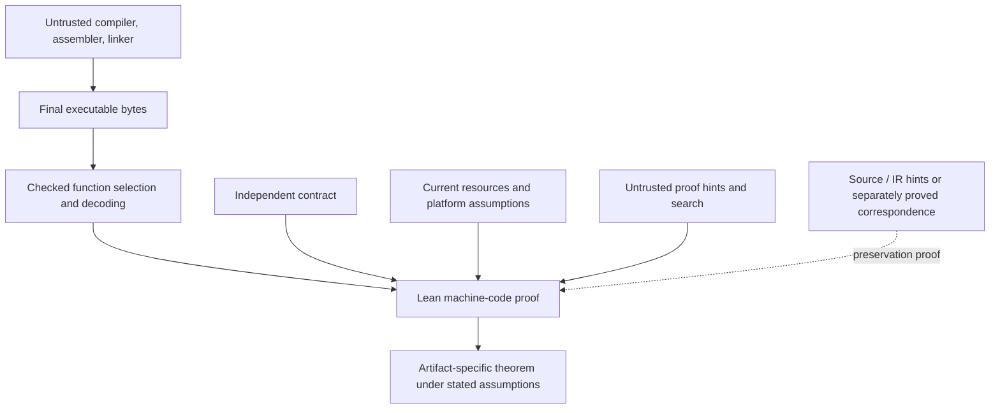

# Legacy binary-verification architecture

> This page records the retained legacy binary-verification architecture and
> scope. The primary path is now [shared source semantics](source-semantics.md),
> proved source definedness/contracts and the [single-seed bootstrap roadmap](roadmap.md).
> Legacy coverage numbers do not measure progress on that path.

eDieSeL implements semantics, proof rules and validators in Lean 4. The retained
binary library verifies restricted x86-64 functions against independent contracts and
binds proofs to raw bytes or selected functions in complete ELF files. Separate
profiles model writable calls, process boundaries and managed concurrency.
See [coverage](coverage.md) for their exact scope.

## The proof boundary

The retained binary route uses [direct binary verification](binary-first.md): treat the
compiler, assembler and linker as producers of candidate bytes, then prove a
property of those bytes. The specification describes the required mathematics,
memory effects and resources independently of the candidate and its checker.
Checker soundness connects acceptance to machine execution.

Raw-byte proofs retain code-placement and caller premises. ELF certificates
add exact-file and selected-function binding through the restricted loading
model; they do not by themselves prove process startup or every function in
the file. The [verification guide](verification.md) explains these layers.

`import EDSL` exposes the reusable sequential checker, scalar and buffer call
contracts, resource adapters and standalone scalar ELF certificates. It excludes
worked examples and frozen corpus clients. `import EDSL.All` loads the full
proof catalogue. The public project name is eDieSeL; `EDSL` remains the Lean
namespace and module prefix. See the [repository map](repository-layout.md).

## Planned components and dependencies

The existing layers and their extension boundaries are:

| Layer | Existing role | Further work |
| --- | --- | --- |
| Behavior | `EDSL.Semantics` defines generic behavior and refinement relations | Richer language-specific observations and composition proofs |
| Machine execution | Restricted x86-64 decoding, sequential execution and specialized concurrent models | Additional instructions, faults, targets and privileged execution |
| Verification | `EDSL.X86.VCGen` supplies sound verification conditions; sparse cutpoints support loop proofs | Broader effects and proof automation within explicit profiles |
| Callable contracts | `EDSL.PureCall` and `EDSL.BufferCall` connect results, ABI frames and current resources | Additional call and resource interfaces |
| Artifact binding | `EDSL.ELF` checks restricted images, selected windows and named functions | General relocation, dynamic loading and deployment composition |
| OS resources | Ownership, lifetimes, mappings, threads and synchronization under selected models | More OS interfaces and concrete implementation proofs |
| Source and IR | [Language-domain design](languages.md) | Typed frontends, source semantics and preservation proofs |

These are separate semantic domains. C pointers, LLVM pointers and machine
addresses need explicit relations; a shared bit width or resource vocabulary
does not make them interchangeable. The complete GNU C23, GNU C++26 and LLVM
frontend pipeline remains planned.

## Lean engineering decisions

- Pin Lean in [lean-toolchain](../lean-toolchain), build with warnings as errors,
  and audit transitive theorem dependencies. A proved claim admits no proof
  holes, project semantic axioms or unchecked solver results.
- Keep semantics and specifications separate from parsers, emitters, command
  drivers and proof search. Reconstruct proof terms or use a checker whose
  soundness is proved against those semantics.
- Make unsupported operations and failure explicit. Rejection supplies no
  theorem; a successful external run or solver response supplies no proof.
- Review hypotheses as well as axioms: admission must describe present inputs
  and authority, and useful admitted states must exist. Assuming a future
  successful run would bypass the central proof obligation.
- Adopt dependencies only with pinned revisions, reviewed scope and audited
  trust requirements. Related libraries are catalogued in the
  [research map](research-map.md).

## OS and platform composition

A correct return value is only part of a program contract. A read needs a live
region and current authority; a write must preserve unrelated memory; a worker
must retain resources until its permitted collection. Synchronization also
depends on interference, memory ordering and progress assumptions. These facts
belong in the execution model and proof, alongside errors and partial effects.

The current target is restricted Linux-style x86-64 userspace with selected
System V call conventions and ELF loading. Each profile records its own
assumptions; the sequential read-only checker does not acquire concurrency or
syscall support by importing an OS module. Native loading, Linux enforcement
and physical CPU correspondence remain external boundaries described in the
[platform model](platform-model.md) and [trust ledger](trust.md).

The [OS implementation track](os-implementation.md) targets concrete kernel,
runtime and driver components. A component proof could discharge an OS contract
only through a matching composition theorem. Kernel execution requires future
privileged-mode semantics, interrupts, page tables and relevant device behavior.
The current userspace model does not establish whole-kernel verification.

## Interface policy

A supported operation needs semantics, ownership and effects, failure behavior,
capability requirements and sound proof rules. Lowering or linking needs an
observation relation, related initial states and environments, and an explicit
termination/divergence policy. A certificate must bind the same specification,
bytes and profile used by its soundness theorem.

Foreign calls, syscalls, inline assembly and raw IR require explicit contracts
or implementation proofs. Missing effects cannot be erased to make a proof
succeed. [Trust](trust.md) distinguishes proved results, environmental contracts
and empirical evidence.
